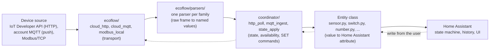

# Architecture and Structure

Where a new file goes, and which layer may import what. Read this before your first pull request that adds a module.

These rules apply to new files and new code. Older files that break them are listed under [Known exceptions](#known-exceptions). Do not copy them as a pattern.

## The two layers

```
custom_components/ecoflow_energy/
    ecoflow/        core library: talks to the device, parses frames, builds commands
    coordinator/    Home Assistant layer: owns the connection, holds the state
    <platform>.py   entities (sensor, binary_sensor, switch, number, select, button, climate)
    const.py        entity definitions and device registry
    config_flow*.py setup, options, reauth and reconfigure screens
```

- Keep `ecoflow/` free of Home Assistant. Do not import `homeassistant` there, not at module level and not inside a function. Reason: the core library is tested without Home Assistant, and a single import makes every parser test depend on it.
- Keep protocol code out of the entity classes, the same way Home Assistant code stays out of the core library. Reason: a parser that needs no Home Assistant can be replayed against a recording in a plain test.
- Put each platform file at the integration root (`sensor.py`, `switch.py`, and so on). Reason: Home Assistant loads a platform only from there.

## Data flow

A value takes one route from the device to the screen. Every step has one owner.



- Decode a value once, in the parser. Do not re-decode or rescale it in the coordinator or in an entity. Reason: two places that interpret the same field drift apart.
- Send commands only through the coordinator's SET path and the core library's command builders. Reason: the read-back wait and the rollback to the previous value live in the coordinator, and a second send path would skip them.

## Where a new file goes

- Add a device parser to `ecoflow/parsers/` (see [Naming](naming.md) for the file name).
- Add SET command builders to `ecoflow/<family>_commands.py`.
- Add coordinator logic to the matching module in `coordinator/` (`http_poll.py`, `mqtt_ingest.py`, `set_commands.py`, `state_apply.py`, `availability.py`, and so on). A new concern gets a new module in that folder, not a new file at the integration root. Reason: the coordinator is built from small mixins, and each one has one job (ADR-022 in the [decision register](../architecture/decisions.md)).
- Add entity definitions to the root `const.py`, the registry of what each device exposes. Add API constants (hosts, ports, device types and prefixes) to `ecoflow/const.py`.
- Add a setup screen step as `config_flow_<step>.py` next to the existing ones.
- Add translations for every new entity key to `strings.json` and to all six files under `translations/`. Reason: the tests hold all six language files to the same key set, so a key missing in one of them fails the suite.
- Keep entity classes thin: they map coordinator data to Home Assistant attributes and nothing more. Reason: logic in an entity cannot be tested without Home Assistant and runs once per entity instead of once per device.
- Add a new device through [Adding Your Device](../add-your-device.md). It walks the files in order, so this page does not repeat that list.

## Decide the mode before you write code

- Pick exactly one of the three modes for your change: Standard (developer keys, HTTP polling), Enhanced (account sign-in, MQTT push) or Local (Modbus/TCP). The [design principles](design-principles.md) explain why they never mix.
- Open an issue first when you are unsure which path carries your data. Reason: choosing the wrong path is the most common reason a device pull request has to be rebuilt.

## Do not reuse a core name

- Do not give a new root module the name of a core module. Reason: two modules with one name look like one when you read an import or a patch string.

## Known exceptions

These files exist as they are and stay as they are. Each has a reason, and renaming them would break patch paths and history for no gain to users. New code follows the rules above, not these files.

| Exception | Why it exists | What to do instead |
|---|---|---|
| `const.py` and `charging_history.py` exist in both `ecoflow/` and the integration root | One per layer, and intentional: the root `const.py` imports Home Assistant (`Platform`), the core one holds API constants. The root `charging_history.py` is the sensor entity, the core one has no Home Assistant import | Do not add a third pair. Name a new root module differently from any core module |
| `energy_stream.py` holds the PowerOcean, PowerGlow and PowerPulse command builders, not an `_commands` file | The PowerOcean builders predate the `<family>_commands.py` pattern | Put new builders in `ecoflow/<family>_commands.py` |
| Single-purpose modules sit directly in `ecoflow/` beside the subfolders (`energy_stream.py`, `energy_integrator.py`, `proto_encoding.py`, `frame_capture.py`, `modbus_local.py`) | One module each, so a folder per module would add nothing | Add a module there only when it is one cross-family helper. Parsers and commands have their homes above |
| `tests/test_entity_definitions.py` imports Home Assistant although it sits in the Home Assistant free test folder | It checks entity definitions, which live in the Home Assistant layer | Put new tests that need Home Assistant in `tests/ha/` (see [Testing](testing.md)) |

Naming exceptions (older parser and builder names) are listed on the [Naming](naming.md) page.
